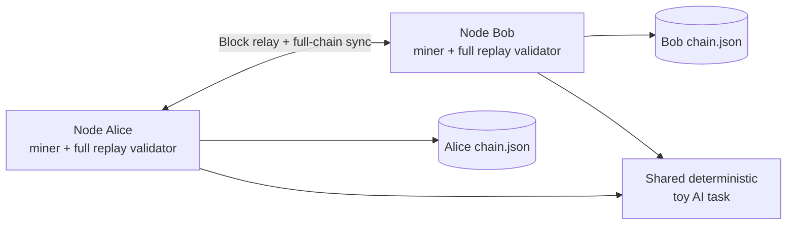

# Verunai private testnet milestone — reproducible two-process demo

## What is real

- Two **independent Python OS processes** with separate mining loops and chains.
- Each process has an HTTP listener on `127.0.0.1`; nodes connect to explicitly configured peers.
- Miners derive a deterministic toy language-model update for each nonce and check a SHA-256 block hash target.
- Nodes relay accepted blocks, reject invalid direct-tip blocks, and asynchronously request entire peer chains when needed.
- Peer chains are **fully replay-verified** before adoption; both independent processes can reconstruct the same model counts and fictional rewards.
- Longer validated chains win. Equal-height chains choose lexicographically smaller block hash for determinism; this is **not** secure chain selection.
- A node persists an accepted chain as JSON using an atomic file replacement and validates its content before restoring.
- The `demo-testnet` command runs two miners, waits for convergence, checks both saved files independently, and reports the resulting blocks.

## Quickest possible demo

Requires Python 3.10+; base demo has no Python dependencies. From the repository root:

```sh
python -m verunai demo-testnet --blocks 8 --difficulty 2 --timeout 30
python -m unittest discover -s tests -v
```

Expected: `"result": "PASS"`, `"independent_processes": 2`, `"chain_height": 8`, `"same_head": true`. Which miner wins will vary between runs. Locally mined orphaned blocks do **not** earn rewards on the converged chain. All rewards are imaginary test units.

## Manual run

Run commands in **two different terminals**, both from this directory. Terminal A:

```sh
python -m verunai node --miner alice --port 8101 --peer http://127.0.0.1:8102 --mine --difficulty 2 --max-blocks 20 --storage alice.json
```

Terminal B:

```sh
python -m verunai node --miner bob --port 8102 --peer http://127.0.0.1:8101 --mine --difficulty 2 --max-blocks 20 --storage bob.json
```

Inspect from a third terminal:

```sh
python -m verunai status --url http://127.0.0.1:8101
python -m verunai status --url http://127.0.0.1:8102
python -m verunai audit alice.json
python -m verunai audit bob.json
```

Both should ultimately show the same `head` after mining stops. They can transiently disagree during races and forks. To restart from the saved chain, use the same `--storage` and difficulty values. `--max-blocks 20` is chain height rather than number of blocks mined by that individual machine.

## HTTP research interface

| Method / route | Purpose |
|---|---|
| `GET /health` | Reachability and research network marker |
| `GET /status` | Chain height, tip, balances, training loss, counters |
| `GET /model` | Aggregated toy training count and loss |
| `GET /chain` | Full export for independently validated chain synchronization |
| `POST /block` | Propose `{"block": {<core block payload>}}`; verifies before acceptance |

There is **no authentication or encryption**. Do not connect a wallet, real monetary assets, external customers, or public Internet to this daemon. The `--allow-lan` setting is just a warning override for isolated laboratory networks, not a safety mechanism.

## What the first testnet does NOT establish

- No proof that costly AI computation cannot be bypassed; the current block race is fundamentally SHA-256 work over a small, reproducible count update.
- No digital signatures, transaction validity rules, chain work accounting, dynamic difficulty, Sybil resistance, DDoS hardening, fee market, or governance.
- No peer discovery, NAT traversal, secure gossip transport, checkpointing, or incremental state sync.
- No proof that model quality improves on unseen questions or that GPU training could be verified deterministically across hardware.
- No profitability, token market price, or claim that the experimental "coins" have value.

## Architecture



## Fork-choice research note

For **fixed difficulty only**, nodes prefer `(height, -int(tip_hash, 16))`, so they eventually select the same valid chain after communication stops. This simplistic rule is educational, easily manipulated by adversarial peers, and may choose based on hash ordering unrelated to honest cumulative work. A future secure design must define full consensus and chain-work accounting, not simply length or a tie-breaking hash.
